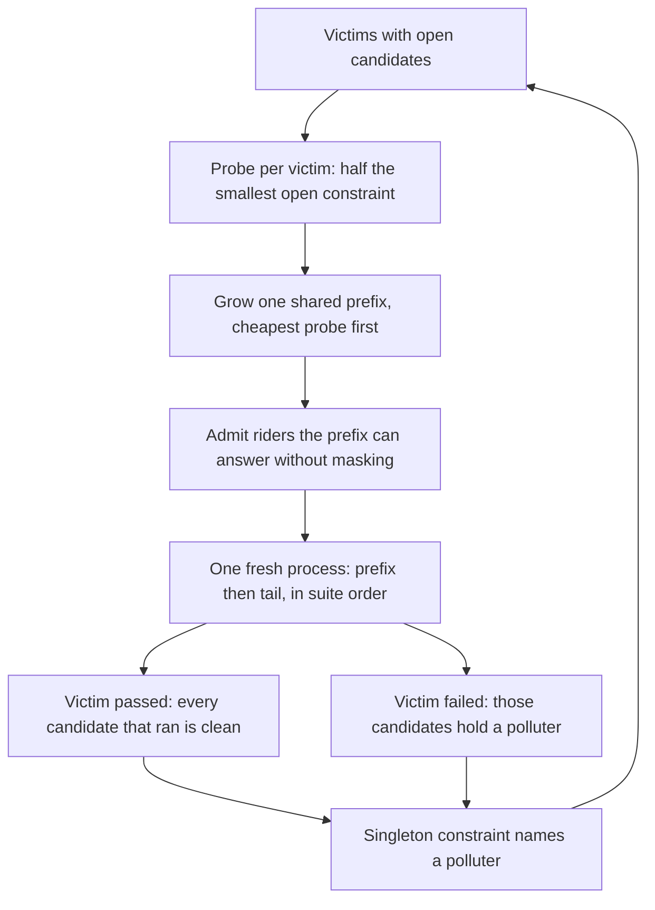
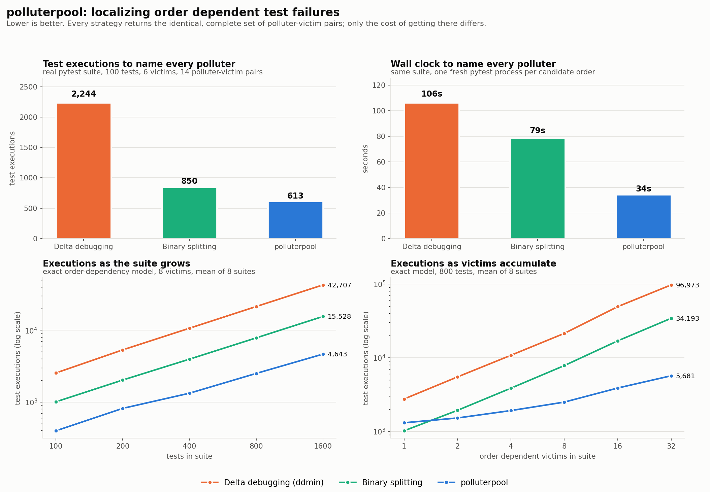

# polluterpool

Find which test pollutes which, by running one shared prefix for every victim at once instead of one prefix per victim.

## The problem

A test that passes on its own and fails inside the suite is an order dependent
test. Something that ran earlier left state behind: a module level dict, an
environment variable, an entry on `sys.path`, a cached singleton. To fix it you
have to name the polluter, and the suite will not tell you which of the
hundreds of tests before it is responsible.

The way this is done today is a search per victim. Pick the victim, run a
prefix of the suite followed by that victim, and bisect the prefix until a
single test is left. That is what the delta debugging reducers and the
order dependent test tooling in the literature do. It works, and it is
expensive, because the cost of a candidate order is dominated by the prefix:
you pay for fifty test executions to learn one bit about one victim. When a
single state leak produces six victims at once, which is the normal case, you
pay that prefix six separate times.

## What it does

`polluterpool` takes a pytest suite, finds every test that passes alone and
fails in suite order, and returns the complete set of polluter to victim pairs,
not just one polluter per victim. It is a drop in replacement for bisecting
each victim by hand, and it reports exactly what it spent.

The core move: a candidate order is a prefix plus a tail, and the prefix is the
expensive part. Appending every unresolved victim to the same prefix turns one
run into one observation per victim, for one extra test execution each. A run
that cost 400 executions to answer one yes or no question now answers six of
them for 405.

Making that sound takes three pieces:

* **Exact service for at least one victim.** The prefix grows from the probe of
  the least recently served victim, cheapest probe first. Another victim's
  probe joins only if the combined prefix still splits that victim's own search
  region exactly where it asked. One victim's binary search therefore advances
  every round, which is what makes the search terminate.
* **Sound inference for everyone else.** Victims that cannot be served exactly
  ride along anyway. Inference is done against the tests that actually ran
  before a victim, not against the split that was requested, so a pooled run is
  always valid even when it is not the split that victim wanted. A pass proves
  every candidate in the prefix clean at once, which is usually the bigger win.
* **Known polluters kept out.** Once a polluter is named, it has to stay out of
  that victim's prefix, or the victim fails for a reason the run already knows
  about and the round teaches it nothing. The same rule applies to victims that
  pollute other victims, which is why those pairs are settled up front.

Knowledge per victim is a set of constraints, each a set of tests known to
contain at least one polluter that has not been named yet. A constraint that
shrinks to one element names a polluter. A victim is finished when every test
before it is either named or proven clean, so the result is the full set of
pairs, with no "there may be more" caveat.

## Why this is not the obvious thing

Group testing is the standard tool for finding few defectives with few tests,
and the standard objective is to minimize the number of pooled measurements.
That objective is wrong here. A measurement is a test suite run, and its cost
is the size of the pool, not one. Minimizing measurements pushes toward large
pools, which are exactly the expensive ones.

What is actually cheap here is a property group testing does not model: a
single measurement can be read by many defect classes at once, because the
tail is shared. The cost of adding the seventh victim to a round is one test
execution, and the information it returns is a full bit about a different
search. That changes the shape of the optimum: pool size is still bounded by
cost, but the number of questions answered per pool is bounded by the number
of open victims rather than by one.

The consequence shows up in the scaling. Per victim bisection is linear in the
number of victims by construction. Pooling is close to flat in it: going from
1 to 32 victims on an 800 test suite takes binary splitting from 1,020 to
34,193 executions, and `polluterpool` from 1,309 to 5,681.

## Architecture

FigJam board: https://www.figma.com/board/yJhAfs5ioPInrsWypEmVOF

The diagram shows the path from a pytest directory to a list of polluter to
victim pairs: collection, victim discovery, victim pair screening, then the
round loop where the planner builds one shared prefix, the oracle runs it in a
fresh process, and per victim inference either proves candidates clean or
records a constraint until every candidate is decided.



## Results



The metric is the cost of going from a known list of victims to the complete,
verified set of polluter to victim pairs. Cost is counted two ways: test
executions, which is hardware independent, and wall clock, which is what a
developer waits through. All three strategies return the identical answer,
checked against the planted ground truth, so only the cost differs.

The baseline is per victim search, which is what the existing tooling does.
Binary splitting is the strong form of it: the prefix of a victim is known to
contain a polluter, so split it and recurse, testing a half only when its
result is not already implied. Delta debugging (ddmin) is the form the flaky
test literature uses, and it is shown because it is what most people reach for.

On the real pytest suite in `examples/demo_suite` (100 tests, 6 victims, 14
planted pairs, one fresh pytest process per candidate order), binary splitting
needs 850 test executions across 101 runs and 78.5 seconds. `polluterpool`
needs 613 executions across 43 runs and 34.5 seconds: 28 percent fewer
executions, 57 percent fewer runs, and 56 percent less wall clock. Delta
debugging needs 2,244 executions and 106.4 seconds. Wall clock improves more
than executions because process startup is charged per run, and pooling cuts
runs harder than it cuts executions.

The two lower panels sweep the exact order dependency model, which is the same
model every strategy already assumes, so that the suite can be grown past what
is affordable to run as real processes. At a fixed 8 victims the gap over
binary splitting widens with suite size, from 2.5x at 100 tests to 3.3x at
1,600. The sharper effect is the victim count: at one victim there is nothing
to share and pooling is 28 percent worse than binary splitting (1,309 versus
1,020 executions), the crossover is at two victims, and by 32 victims pooling
is 6.0x cheaper. That is the honest shape of the result. If exactly one test in
your suite is order dependent, bisect it; the moment a state leak takes down
several tests at once, which is the case that actually hurts, pooling wins and
keeps winning.

## How to run it

```bash
git clone https://github.com/joelvarun/polluterpool
cd polluterpool
python -m pip install -r requirements.txt
```

Point it at a flat directory of pytest modules:

```bash
python -m polluterpool examples/demo_suite
```

Useful flags:

```bash
python -m polluterpool examples/demo_suite --runner worker     # skip pytest startup per run
python -m polluterpool examples/demo_suite --strategy bisect   # the baseline, for comparison
python -m polluterpool examples/demo_suite --json found.json   # machine readable output
```

Reproduce the chart end to end:

```bash
python examples/gen_suite.py          # regenerate the planted suite (deterministic)
python bench/run_real.py              # real pytest processes, writes docs/results_real.json
python bench/sweep.py                 # exact-model scaling, writes docs/results_sweep.json
python bench/make_chart.py            # writes docs/before_after.png
```

`bench/run_real.py` takes about four minutes because it starts 274 pytest
processes on purpose. `bench/sweep.py` takes about a minute. Run the project's
own tests with:

```bash
python -m pytest
```

Two notes on scope. The suite directory is expected to be flat, so that a bare
`file.py::function` node id is unambiguous for both runners. And the search
assumes the standard order dependency model: a victim fails if and only if at
least one polluter ran before it in the same process. That is the model the
existing tooling assumes too. Cleaner tests, which undo a polluter's damage,
break the monotonicity it rests on and are out of scope; the search raises
rather than returning a wrong answer if it meets a contradiction.

## Example output

```
$ python -m polluterpool examples/demo_suite --runner worker
100 tests collected, 6 order dependent victims
  test_seg01.py::test_t0016  pollutes  test_seg03.py::test_t0032
  test_seg02.py::test_t0028  pollutes  test_seg03.py::test_t0032
  test_seg00.py::test_t0004  pollutes  test_seg05.py::test_t0050
  test_seg01.py::test_t0013  pollutes  test_seg05.py::test_t0050
  test_seg04.py::test_t0045  pollutes  test_seg05.py::test_t0050
  test_seg02.py::test_t0022  pollutes  test_seg05.py::test_t0055
  test_seg02.py::test_t0026  pollutes  test_seg05.py::test_t0055
  test_seg01.py::test_t0016  pollutes  test_seg05.py::test_t0057
  test_seg02.py::test_t0026  pollutes  test_seg05.py::test_t0057
  test_seg05.py::test_t0051  pollutes  test_seg05.py::test_t0057
  test_seg01.py::test_t0018  pollutes  test_seg07.py::test_t0074
  test_seg01.py::test_t0012  pollutes  test_seg07.py::test_t0075
  test_seg01.py::test_t0018  pollutes  test_seg07.py::test_t0075
  test_seg07.py::test_t0074  pollutes  test_seg07.py::test_t0075
discovery: 106 executions in 7 runs; localization (pool): 613 executions in 43 runs, 6.9s
```

Two of those pairs are a victim polluting another victim (`test_t0051` into
`test_t0057`, `test_t0074` into `test_t0075`), which is the case that makes a
shared tail unsound if it is not settled first.

The benchmark driver prints the comparison directly:

```
$ python bench/run_real.py
discovery: 6 victims, 106 executions, 7 runs, 6.4s
Delta debugging (ddmin)      2244 executions    123 runs    106.4s
Binary splitting              850 executions    101 runs     78.5s
polluterpool                  613 executions     43 runs     34.5s
```

Measured on Python 3.13.5 with pytest 9.0.2 on Windows 11. Discovery is one
full suite run plus one isolation run per failing test; it is identical for all
three strategies and is reported separately so the comparison is only over the
part the strategy controls.

## Layout

```
polluterpool/
  suite.py          ordered test ids and suite order helpers
  oracle.py         cost accounting, the pytest runner, the fast runner, the exact model
  worker.py         fresh process that imports modules and calls test functions in order
  pytest_report.py  pytest plugin that records execution order and outcomes
  discover.py       victim discovery
  baselines.py      per victim binary splitting and delta debugging
  pool.py           shared prefix planner, constraint store, the search loop
  cli.py            command line entry point
examples/
  gen_suite.py      generator for the planted suite
  demo_suite/       100 real pytest tests, 14 planted polluter-victim pairs
bench/
  run_real.py       real pytest benchmark
  sweep.py          exact-model scaling sweep
  make_chart.py     renders docs/before_after.png
tests/              randomized equivalence tests against the exact model
```

## License

MIT
